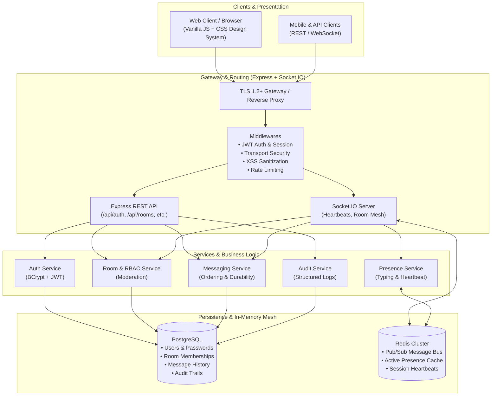

# HyperChat — Real-Time Scalable Chat Platform

[](https://nodejs.org/)
[](https://expressjs.com/)
[](https://socket.io/)
[](https://www.postgresql.org/)
[](https://redis.io/)
[](https://jestjs.io/)
[](LICENSE)

An enterprise-grade, event-driven real-time chat application engineered for low latency, high concurrency, and horizontal scalability. Built with **Node.js**, **Express**, **Socket.IO**, **PostgreSQL**, and **Redis**, HyperChat combines distributed WebSocket gateway clustering with durable persistence, granular Role-Based Access Control (RBAC), and rigorous security controls.

---

## Table of Contents
- [Architecture Overview](#architecture-overview)
- [Key Features](#key-features)
- [Technology Stack](#technology-stack)
- [Repository Structure](#repository-structure)
- [Getting Started](#getting-started)
  - [Prerequisites](#prerequisites)
  - [Installation](#installation)
  - [Environment Configuration](#environment-configuration)
  - [Database Migrations & Seeding](#database-migrations--seeding)
  - [Running the Application](#running-the-application)
- [API & WebSocket Specifications](#api--websocket-specifications)
  - [REST API Endpoints](#rest-api-endpoints)
  - [Socket.IO Events](#socketio-events)
- [Security & Compliance](#security--compliance)
- [Testing Strategy & Quality Assurance](#testing-strategy--quality-assurance)
- [Contributors & Project Information](#contributors--project-information)

---

## Architecture Overview

HyperChat follows a layered, micro-service-ready event-driven architecture designed to decouple real-time socket handling from persistent storage and business logic.



---

## Key Features

- **⚡ Real-Time Low-Latency Messaging**: Bi-directional communication over WebSockets with optimistic client delivery, sub-20ms message broadcast, and automatic reconnection.
- **💬 Channels & Direct Conversations**: Support for public discovery channels, private invite-only rooms, and 1-to-1 direct messaging threads.
- **🟢 Live Presence & Typing Engine**: Redis-backed presence tracking with heartbeat monitoring and debounced typing notifications.
- **🛡️ Role-Based Access Control (RBAC)**: Hierarchical permission engine (`Owner` > `Admin` > `Moderator` > `Member`) supporting granular actions:
  - User mute with customizable duration (5m, 15m, 1h, 24h).
  - Room ban and eviction.
  - Channel member expulsion.
  - Message deletion.
- **📋 Immutable Audit Trail**: All administrative and moderation events generate structured, queryable audit logs (`action`, `actor`, `target`, `timestamp`, `reason`).
- **🔒 Enterprise Security by Design**:
  - Transport Layer Security (TLS 1.2+) enforcement.
  - Server-side multi-layer XSS sanitization (`sanitizeMessage`) for script tags and malicious attributes.
  - Cryptographic password hashing using `bcrypt`.
  - Stateless JSON Web Tokens (JWT) for API and socket session handshakes.
  - Protection against SQL injection using parameterized queries (`pg` pool).
- **📈 Horizontal Scalability**: Redis Pub/Sub multiplexing enables transparent cross-instance message broadcast across multi-node server clusters.
- **🎨 Refined Modern UI**: Hand-crafted, responsive interface featuring ambient dark mode, glassmorphism, micro-interactions, emoji reactions, and collapsible management panels.

---

## Technology Stack

| Layer | Technologies |
| :--- | :--- |
| **Runtime & Backend** | Node.js (v18+), Express 5.x |
| **Real-Time Communication** | Socket.IO (v4.8.x) |
| **Relational Database** | PostgreSQL (v14+) with `pg` connection pooling |
| **In-Memory Cache & Bus** | Redis (v6+) with Pub/Sub cluster adapter |
| **Security & Auth** | JSON Web Tokens (`jsonwebtoken`), BCrypt (`bcrypt`), CORS |
| **Testing & Load** | Jest, Supertest, Artillery |
| **Frontend Client** | Semantic HTML5, Vanilla JavaScript (ES2022+), CSS Custom Properties |

---

## Repository Structure

```text
├── src/
│   ├── app.js               # Express application initialization & middleware pipeline
│   ├── server.js            # HTTP server, WebSocket attachment, and lifecycle management
│   ├── cache/               # Redis client connection and Pub/Sub adapters
│   ├── config/              # Centralized environment variable schema
│   ├── controllers/         # REST API route controllers
│   ├── db/                  # PostgreSQL connection pool, migration scripts, and seeds
│   │   ├── migrations/      # Versioned up/down SQL migration files
│   │   ├── migrate.js       # CLI runner for schema migrations
│   │   └── pool.js          # Resilient PG client pool wrapper
│   ├── middlewares/         # Middlewares (JWT auth, RBAC authorization, TLS validation, error handlers)
│   ├── models/              # Data access layers (User, Room, Message, AuditLog)
│   ├── routes/              # Express API route declarations
│   ├── services/            # Core business domains (Auth, Messaging, Rooms, Presence, Audit)
│   ├── sockets/             # Socket.IO connection dispatchers & event handlers
│   └── utils/               # Sanitizers, logger, and formatting helpers
├── public/                  # Static frontend client interface
│   ├── index.html           # Main chat web client application
│   ├── css/
│   │   └── style.css        # Bespoke design system & modern dark UI stylesheet
│   └── js/
│       └── app.js           # Client application controller & WebSocket manager
├── tests/                   # Comprehensive test suite
│   ├── auth.test.js         # Authentication unit and boundary tests
│   ├── db.test.js           # Database connectivity and repository tests
│   ├── health.test.js       # Health check API tests
│   ├── rbac.test.js         # RBAC permission hierarchy tests
│   ├── services.test.js     # Business logic unit tests
│   ├── socket.test.js       # Live Socket.IO handshake and message flow tests
│   ├── tls.test.js          # Transport layer security tests
│   ├── xss.test.js          # Cross-Site Scripting sanitization tests
│   └── performance/         # Artillery load scenarios (HTTP + WebSocket)
├── .env.example             # Template for environment configuration
├── package.json             # Project dependencies and npm scripts
└── README.md                # Project documentation
```

---

## Getting Started

### Prerequisites
- **Node.js**: >= 18.x
- **npm**: >= 9.x
- **PostgreSQL**: >= 14.x (Local instance or Docker container)
- **Redis**: >= 6.x (Local instance or Docker container)

### Installation
Clone the repository and install project dependencies:
```bash
git clone https://github.com/SE-Mini-Proj/SE_MP.git
cd SE_MP
npm install
```

### Environment Configuration
Copy the sample environment file to create your local `.env`:
```bash
cp .env.example .env
```

Review and adjust variables in `.env`:
```ini
# Application Port & Node Environment
PORT=3000
NODE_ENV=development

# JWT Secret & Token Expiry
JWT_SECRET=your_super_secret_jwt_key_here
JWT_EXPIRES_IN=24h

# PostgreSQL Configuration
DB_HOST=localhost
DB_PORT=5432
DB_NAME=realtime_chat
DB_USER=postgres
DB_PASSWORD=postgres

# Redis Configuration
REDIS_HOST=localhost
REDIS_PORT=6379
REDIS_PASSWORD=
```

### Database Migrations & Seeding
Execute database migrations to provision the schema:
```bash
# Run schema migrations
npm run db:migrate

# (Optional) Seed initial users, channels, and test data
npm run db:seed
```

### Running the Application

```bash
# Start in development mode with live reload
npm run dev

# Start in production mode
npm start
```

Once started, navigate to `http://localhost:3000` in your web browser to open the chat interface.

---

## API & WebSocket Specifications

### REST API Endpoints

| Method | Endpoint | Description | Auth Required |
| :--- | :--- | :--- | :--- |
| `GET` | `/api/health` | Service health status & database connectivity check | No |
| `POST` | `/api/auth/register` | Register a new user account | No |
| `POST` | `/api/auth/login` | Authenticate and obtain JWT bearer token | No |
| `GET` | `/api/rooms` | List accessible rooms for the current user | Yes |
| `POST` | `/api/rooms` | Create a new channel (public or private) | Yes |
| `GET` | `/api/rooms/:roomId/messages` | Retrieve paginated message history | Yes |
| `POST` | `/api/rooms/:roomId/members/:userId/mute` | Mute a member for a specified duration | Yes (Mod+) |
| `POST` | `/api/rooms/:roomId/members/:userId/unmute` | Unmute a previously muted member | Yes (Mod+) |
| `POST` | `/api/rooms/:roomId/members/:userId/ban` | Ban and evict a member from a room | Yes (Admin+) |
| `POST` | `/api/rooms/:roomId/members/:userId/unban` | Lift a member's room ban | Yes (Admin+) |
| `DELETE` | `/api/rooms/:roomId/members/:userId` | Expel/kick a user from the channel | Yes (Mod+) |
| `DELETE` | `/api/rooms/:roomId/messages/:messageId` | Delete a message (recorded in audit trail) | Yes (Mod+ / Author) |
| `GET` | `/api/rooms/:roomId/audit-logs` | Retrieve structured audit logs for the room | Yes (Mod+) |

### Socket.IO Events

#### Client → Server
| Event | Payload | Description |
| :--- | :--- | :--- |
| `room:join` | `{ roomId }` | Join room channel broadcast mesh |
| `room:leave` | `{ roomId }` | Leave room channel |
| `message:send` | `{ roomId, text, clientMsgId }` | Send a new message to the room |
| `typing:start` | `{ roomId }` | Notify channel that user is typing |
| `typing:stop` | `{ roomId }` | Notify channel that typing has ceased |

#### Server → Client
| Event | Payload | Description |
| :--- | :--- | :--- |
| `connection:ack` | `{ status, userId, timestamp }` | Handshake acknowledgment and ping check |
| `message:receive` | `{ messageId, roomId, senderId, text, timestamp }` | Inbound real-time message broadcast |
| `typing:update` | `{ userId, isTyping, roomId }` | Real-time typing status changes |
| `user:joined` | `{ userId, roomId }` | Member entered room |
| `user:left` | `{ userId, roomId }` | Member exited room |
| `user:online` | `{ userId }` | Global presence online notification |
| `user:offline` | `{ userId }` | Global presence offline notification |

---

## Security & Compliance

HyperChat integrates multi-tier defense-in-depth security:

1. **Transport Layer Security (TLS 1.2+)**: Strict rejection of unencrypted transport on production channels.
2. **OWASP XSS Neutralization**: Server-side HTML entity encoding and attribute sanitization preventing stored and reflected XSS attacks.
3. **Role-Based Access Enforcement**: Route and socket-level middleware guarantees unprivileged users cannot execute administrative or moderation commands (enforcing HTTP `403 Forbidden`).
4. **Credential Cryptography**: Passwords salted and hashed with `bcrypt` (10 rounds).
5. **SQL Injection Immunization**: All Postgres queries use parameterized statements with strict type casting.
6. **Immutable Audit Logs**: Moderation events are stored in structured audit log tables with actors, targets, actions, and timestamps.

---

## Testing Strategy & Quality Assurance

HyperChat maintains high test coverage through automated unit, integration, and load testing suites.

```bash
# Run complete test suite
npm test

# Run service unit tests
npm run test:unit

# Run database and Socket.IO integration tests
npm run test:integration

# Run performance and load testing scenarios (Artillery)
npm run test:load

# Check code formatting & linting
npm run lint
```

### Performance & Load Testing
Performance testing is conducted with **Artillery** under `tests/performance/`:
- **HTTP Scenario**: Exercises `/api/health` at 10 new virtual users/sec for 60 seconds with strict p95 latency thresholds (< 500ms).
- **WebSocket Scenario**: Simulates concurrent client connections, room subscriptions, and real-time message broadcasting.

---

## Contributors & Project Information

**Software Engineering Mini Project (SE_MP)**  
Department of Computer Science & Engineering

### Project Authors
- **Pranay Shah**
- **Nikhil Mahabala Shekar**
- **Prarthana Herur**
- **Nikhil B Menon**

---

### License
This project is licensed under the [ISC License](LICENSE).
